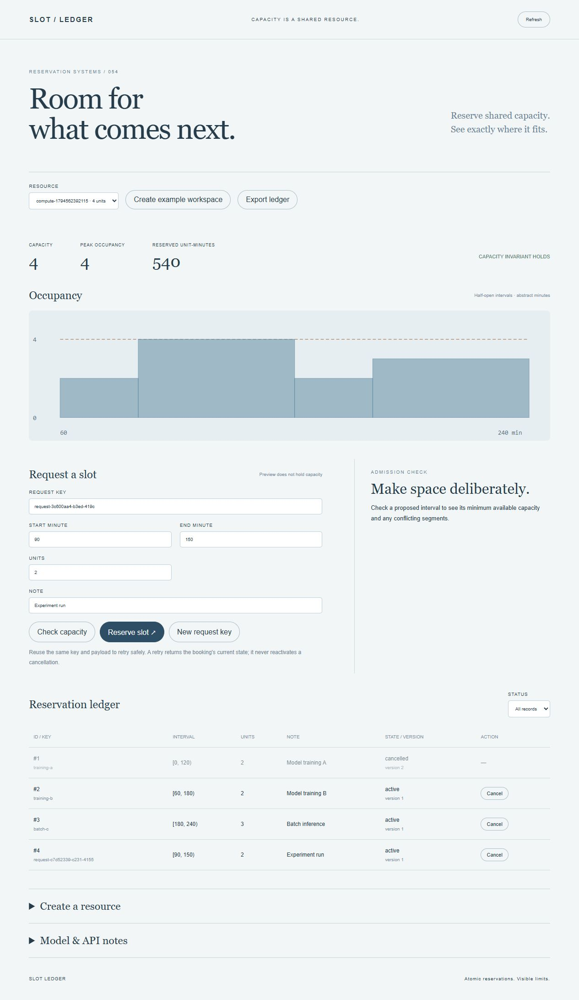

# Slot Ledger

A durable capacity-reservation API with a quiet, inspectable frontend. Reserve quantities over half-open intervals, explain conflicts, cancel with version checks, and retry accepted requests without double booking.



## Run

Requires Python 3.10+; no runtime dependencies.

```sh
python run.py --port 8000
```

Open http://127.0.0.1:8000 and choose **Create example workspace**. This persists a resource with four units and three example reservations. The default proposed interval [90,150) needs two units but overlaps a fully occupied segment [90,120). Cancel booking #1, then reserve: the request succeeds. Submitting the same key and payload again returns the existing booking without consuming more capacity.

The database is `data/slots.sqlite3`, ignored by Git. Override it with `--database PATH`. For a consistent backup, stop the server and copy the data directory, including any SQLite sidecars. The UI supports creating additional immutable-capacity resources, filtering active/cancelled reservations, refreshing external changes, and exporting the displayed ledger as JSON.

## Transaction semantics

- Admission runs an overlap sweep and inserts the booking within a single SQLite `BEGIN IMMEDIATE` transaction. Competing writers cannot both pass against the same free capacity.
- Intervals are `[start,end)` in **abstract integer minutes**, within [0,525600]. Endpoints at the same minute release and acquire capacity without overlap. No calendar, locale, clock or time-zone conversion occurs.
- Shared capacity is a positive integer; each booking consumes its quantity throughout its interval. Conflict evidence reports exact segments, existing booking IDs, requested units and excess.
- `(resource,request_key)` identifies a request. Repeating its identical validated payload returns the same booking ID and its **current** state. A different payload yields HTTP 409. A cancelled booking stays cancelled on retry; use a new key to book again.
- Rejected capacity requests do not consume their request key. Previews hold nothing and are advisory; admission rechecks inside the write transaction.
- Cancellation checks `expected_version`. Active version 1 becomes cancelled version 2. A stale version conflicts; repeating cancellation with version 2 returns the unchanged cancelled record.
- Read snapshots use one transaction for resource, bookings and computed occupancy. The displayed export reflects the last loaded snapshot; refresh to obtain external changes.

This is a loopback demonstration, not a hosted multi-user booking service. It has no authentication, payment, automatic expiry, background scheduler, booking edits or capacity resizing. Cancellation is permanent in this model; create a new booking to reserve again. Limits are 100 resources, 500 bookings per resource, 10,000 globally including cancelled history, quantities/capacity up to 1000, and 8 KB JSON request bodies.

## API

| Method | Path                                | Purpose                                  |
| ------ | ----------------------------------- | ---------------------------------------- |
| GET    | `/api/resources`                    | List resources                           |
| POST   | `/api/resources`                    | Create `{name,capacity}`                 |
| GET    | `/api/resources/{name}`             | Consistent ledger and occupancy snapshot |
| POST   | `/api/resources/{name}/preview`     | Read-only capacity check                 |
| POST   | `/api/resources/{name}/reserve`     | Atomic reservation or idempotent retry   |
| POST   | `/api/resources/{name}/cancel/{id}` | Cancel with `{expected_version}`         |

Preview and reserve use the same payload:

```json
{
  "request_key": "training-001",
  "start": 90,
  "end": 150,
  "units": 2,
  "note": "Experiment run"
}
```

New reservations return 201; retries return 200. Capacity, key-reuse and version conflicts return 409. Capacity conflicts include segment evidence in `details`. Unknown resources/bookings return 404; invalid payloads 400. Resource names/request keys use 1–48 ASCII letters, digits, underscores or hyphens, beginning with a letter/digit. Notes allow up to 120 Unicode characters, excluding control characters and surrogates. Integer fields reject booleans and JSON floats.

## Verification and architecture

```sh
python -m unittest discover -s tests -v
npm run check
```

Node 22+ is only needed for the frontend syntax check. Thirteen Python tests cover the HTTP lifecycle, origin/Host/body limits, static-file isolation, interval boundaries, version conflicts, durable reopening, resource isolation, injected transaction rollback, twenty competing reservations and twelve simultaneous retries. Three hundred generated interval sets are checked against a minute-by-minute occupancy oracle; two hundred admission decisions are checked against an independent load array. CI runs Python 3.11 and 3.13 on Linux and Windows.

Browser checks verified a conflict with exact booking IDs, cancellation releasing capacity, reservation after rejection, identical retries, changed-payload conflicts, reload persistence and JSON export. The example after cancellation and successful replacement has peak occupancy 4 and 540 reserved unit-minutes.

`store.py` owns validation, endpoint sweeps and SQLite transactions. `run.py` exposes the API and an explicit static asset allowlist. `app.js` manages forms, server snapshots and the SVG occupancy chart. All application requests stay on the local server; there are no CDN assets or external analytics.
